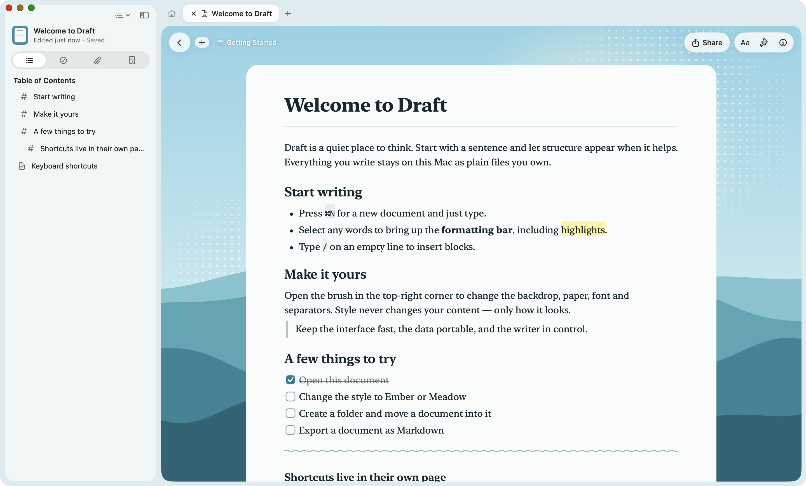

# Draft

A free, open-source, local-first notes and document app. **First release: native macOS.**
No account and no telemetry — your notes are plain files on your Mac. Nothing goes online unless you
turn it on (image search, link previews, downloading the Assistant's local model, or the optional
OpenAI Assistant with your own API key).



## Build and run

Requirements: macOS 14 or later, Xcode 16+ (Swift 6 toolchain) with the Metal Toolchain component
(`xcodebuild -downloadComponent MetalToolchain`). SwiftPM fetches two pinned dependencies: the
llama.cpp XCFramework and Libraries.dev (see [`THIRD_PARTY_NOTICES.md`](THIRD_PARTY_NOTICES.md)).

```bash
scripts/build-app.sh          # builds build/Draft.app (release)
```

```bash
open build/Draft.app
```

Development loop and checks:

```bash
swift run Draft               # run without bundling
```

```bash
swift test                    # 147 tests: format, schema 2 migration, vault, index, links, tags, dates, styles, tables, collections, import, HTML/site export, online parsing, editor, blocks, paste, grouping, media, cursor, Assistant retrieval, citations, prompts, chat history, model download verification, privacy, cancellation, one-step undo
```

```bash
scripts/smoke.sh              # end-to-end: edit, group, trash, quit, relaunch; verify content, page, trash, backups, search, link, ungroup
```

```bash
scripts/perf.sh               # opens a 10,000-block document and checks editing and index-rebuild budgets
```

```bash
scripts/links-test.sh         # links, backlinks, tasks, daily notes: write, relaunch, delete index/ and relaunch
```

```bash
scripts/style-test.sh         # saved styles, block fonts, cards, separators; styled PDF/HTML/PNG and an offline site
```

```bash
scripts/drag-test.sh          # drags a block with mouse events posted through the app; checks undo, redo, relaunch
```

```bash
scripts/structure-test.sh     # tables and collections: views, sort, sums, Kanban drag undo, CSV round trip; 1,000-item open and scroll
```

```bash
scripts/workflow-test.sh      # Spaces, templates, Draft JSON and Markdown import round trips
```

```bash
scripts/ux-perf.sh            # tab and Space switching, library, scrolling, panels, idle CPU/GPU
```

```bash
scripts/assistant-test.sh     # the Assistant with all networking denied (needs the downloaded model)
```

```bash
scripts/assistant-quality.sh  # 30-question benchmark: expected facts and citations, offline
```

```bash
scripts/agent-test.sh         # Codex/MCP proposals: accept, undo, reject, stale revision, links/tags/tasks kept
```

## Local Assistant

Press ⌘J (or the Assistant button). The first time, Draft offers to download **LFM2.5-2.6B** by
Liquid AI (1.6 GB, open weights under the LFM Open License v1.0, not Draft's license). The file is
checked against its published SHA-256 and stored in `~/Library/Application Support/Draft/Models`,
outside your vault. Inference runs inside Draft with llama.cpp on Metal: no Python, server, account or
API key, and it works with networking off. Notes are never sent anywhere. Settings → Assistant
switches to the smaller 1.2B model or removes the model.

It reads a long document in parts and says so, answers a second question about the same note several
times faster (the model's state after reading the note is kept), reads answers aloud with the
system voice, and takes dictation only through Apple's on-device recognizer (Draft refuses
server-based recognition; macOS asks for microphone and speech permission the first time).

**Optional OpenAI provider.** Settings → Assistant → provider *OpenAI API* uses your own API key
(stored in the macOS Keychain, never in the vault) and the Responses API with `store: false`. Before
every request Draft shows exactly which note text and earlier turns will be sent, and nothing is
sent until you confirm. This is not ChatGPT sign-in and not a Codex agent inside Draft; local
remains the default.

## Codex, Claude Code and other MCP clients

`scripts/draft-mcp.sh` runs `DraftMCP`, a local stdio MCP server over your vault (or `--vault <folder>`).
It lists Spaces, folders and documents, searches, reads documents, blocks and structure, describes
Draft's formatting (with a restrained "make it look better" recipe), and **proposes** changes:
note edits (text, append, insert, delete, reorder, headings, lists, tasks, quotes, callouts, code,
inline formatting, colours, highlights, links, block colours, focus and block decorations,
separators, document style) and creating, renaming and moving notes.

A proposal is only a file in `agent-requests/`. Draft shows it in a review sheet with before and
after for each change; nothing happens until you click Apply. Draft then checks the note (or the
folders) haven't changed since the agent read them, saves with a backup, updates the index, and the
whole proposal is one Undo. Reject leaves everything as it was. Draft never deletes images, files,
tables or nested pages from a proposal, and whole-note replacement is refused for notes that have them.

Setup: Codex — add `[mcp_servers.draft] command = "<repo>/scripts/draft-mcp.sh"` to
`~/.codex/config.toml`. Claude Code — `claude mcp add draft -- <repo>/scripts/draft-mcp.sh` (or the
`mcpServers` entry in `~/.claude.json`). Keep Draft open to review proposals; they wait if it's closed.
`scripts/mcp-test.sh` checks the whole loop in a throwaway vault.

## Architecture (v0.1)

| Layer | Target | Notes |
|---|---|---|
| Portable format | `Sources/DraftCore` | Foundation only. Document tree, library index, migrations, vault (atomic writes), Markdown/JSON export, styles, seed content. This is the layer a future Windows app re-implements; see [`docs/FORMAT.md`](docs/FORMAT.md). |
| Editor | `Sources/DraftEditor` | AppKit + **TextKit 1** (`NSTextView`, custom `NSLayoutManager`). One text paragraph = one block with a stable id. Semantic attributes (block info, inline marks) are separate from derived display attributes. |
| App shell | `Sources/Draft` | SwiftUI: rail, tabs, library, panels, settings, Assistant. Hosts the editor through `NSViewRepresentable`. Design tokens in `DesignSystem.swift`. |
| Assistant runtime | `Sources/DraftAssistant` | Model download and verification, llama.cpp engine. Prompting, retrieval and history are in `DraftCore` (`Assistant.swift`). |

Key decisions:

- **Four separate layers**: semantic content (`content`), inline marks (inside content), block style
  (`blockColor`, `decoration`, `textAlign` attrs), document appearance (`appearance`: style id +
  sparse overrides + cover). Restyling never touches content (tested).
- **One command registry** (`EditorCommands`) drives the selection toolbar, `Aa` panel, slash menu,
  `+` insert menu, menu bar and shortcuts; every command is undoable through `NSTextView`'s undo.
  Markdown conversions run as their own undo step, so ⌘Z restores the literal text.
- **Selection toolbar** is an AppKit overlay that never takes focus from the text, so the selection
  survives the color palette and link field; it flips below near the top, clamps horizontally,
  dismisses with Esc, and is keyboard reachable with ⌥F10 (←/→, Return, Esc).
- **Storage**: `library.json` (index) + one JSON file per document + content-addressed `assets/`.
  Explicit schema versions; migrations back up the original first; files from a newer schema open
  read-only; unknown fields and unknown block types are preserved verbatim.
- **Nested pages** are child documents referenced by a `pageCard` block (card or page presentation).
- The earlier Electron prototype was replaced; its data format, styles, seed copy, export rules and
  migration design were ported to `DraftCore` unchanged in spirit.

## Docs

- [`docs/ROADMAP.md`](docs/ROADMAP.md) — versioned plan from v0.1 to 1.0 and beyond (incl. Windows).
- [`docs/FEATURE_PARITY.md`](docs/FEATURE_PARITY.md) — evidence-backed gap matrix with acceptance checks.
- [`docs/FORMAT.md`](docs/FORMAT.md) — the portable on-disk format.
- [`docs/screenshots/`](docs/screenshots) — Draft captured by `DRAFT_AUTOMATION=screenshots`.

Reference screenshots of other products used during design research are **not** part of this
repository and must not be committed. All Draft artwork (scenes, separators, icon) is original and
generated in code.
