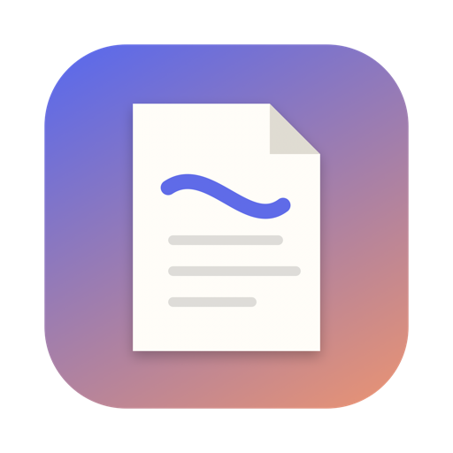
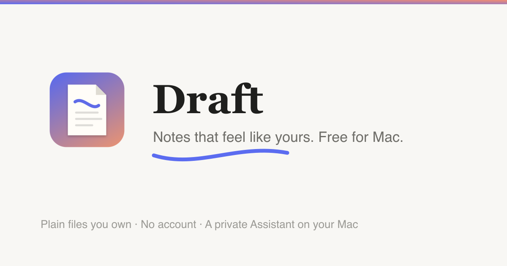
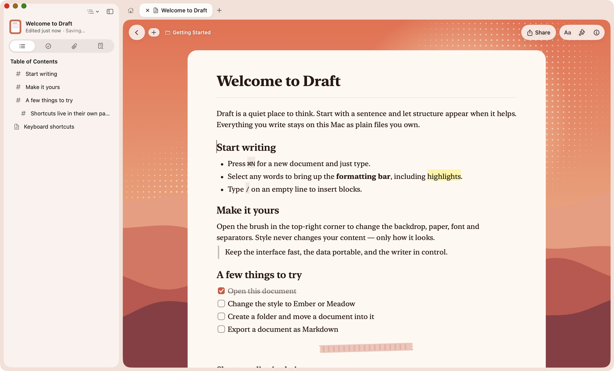
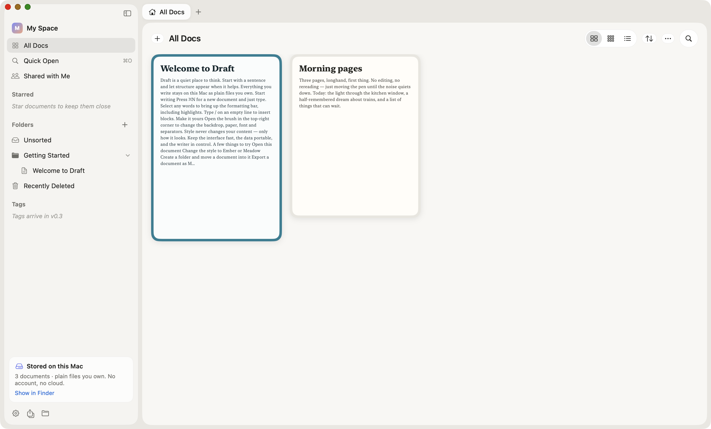
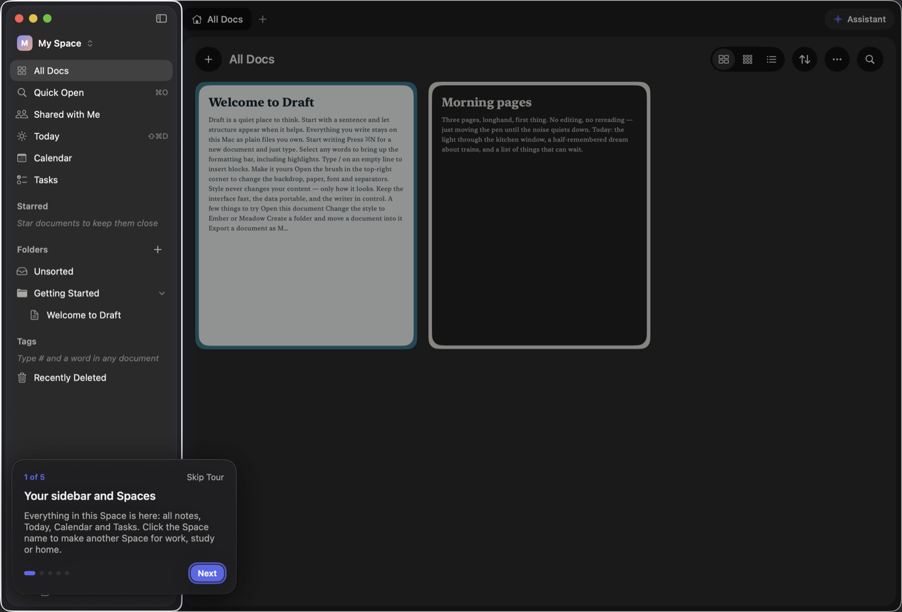
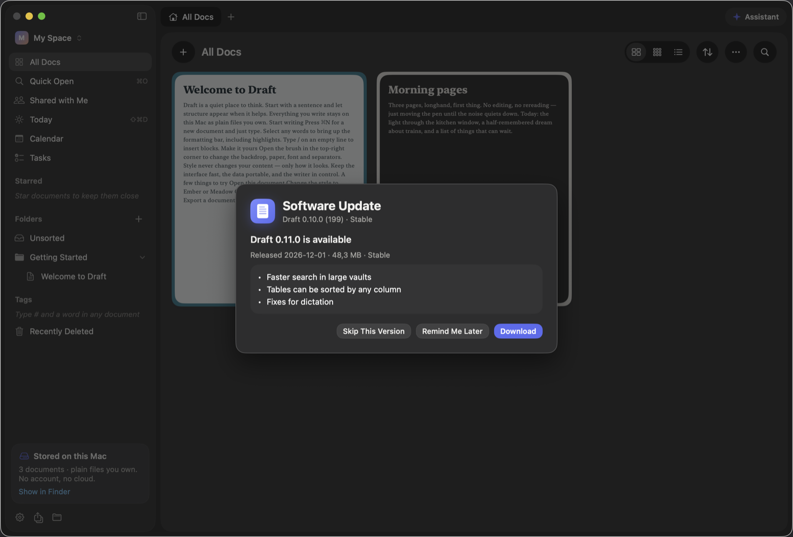

# Draft

### Quiet notes. Owned by you.

A free, open-source, local-first notes app for macOS — built for writing, thinking and making beautiful documents without giving up control of your data.

  <a href="https://draftnotes.app"><strong>Website</strong></a> ·
  <a href="https://github.com/Mixiee3/draft/releases"><strong>Download</strong></a> ·
  <a href="docs/ROADMAP.md"><strong>Roadmap</strong></a> ·
  <a href="https://github.com/Mixiee3/draft/discussions"><strong>Discussions</strong></a>

  

> Draft is a calm place to write first and organise later. Your notes remain plain, portable files on your Mac. No account is required, and nothing leaves your computer unless you explicitly turn on a network feature.

## Why Draft?

Most note apps make you choose between a beautiful writing space and ownership of your data. Draft is an attempt to keep both.

- **Local by default** — your vault lives on your Mac, not in a mandatory cloud account.
- **A real writing environment** — rich blocks, keyboard-first editing, document styles and quiet visual details.
- **Portable files** — one JSON document per note, content-addressed assets and documented migrations.
- **Private AI options** — a local Liquid AI model can answer questions about your notes with networking disabled.
- **Reviewed automation** — Claude Code, Codex and other MCP clients can propose edits, but Draft asks before applying them.
- **Open source** — inspect the storage format, test the app and help shape what comes next.

## A glimpse of Draft

 

More states are available in [docs/screenshots](docs/screenshots/).

## What Draft can do

### Write and organise

Rich blocks, headings, lists, tasks, quotes, code, callouts, separators, nested pages, tables, collections, tags, backlinks, daily notes, calendar views and cross-document search.

### Make documents feel like yours

Original paper and scenic styles, gradients, textures, dots, separators, covers, block treatments, text effects, Spectrum animation, styled HTML/PDF/PNG export and offline website export.

### Work with an Assistant

Draft’s default Assistant runs locally through llama.cpp and Metal. It can retrieve facts from long notes, cite source blocks, shorten or rewrite text, read answers aloud and work with networking turned off. An optional OpenAI provider is separate, uses your own API key and asks before sending selected note content.

### Let agents help — safely

The local MCP server exposes reading and proposal tools for Codex, Claude Code and other clients. Agents can propose note, block, table, collection, style and attachment changes. Draft shows a before/after review sheet, checks revisions, makes a backup and applies the entire proposal as one undoable change.

## Privacy model

Draft does not require an account and does not include telemetry. Local Assistant inference stays on-device. Network features such as image search, link previews, model downloads, optional OpenAI requests and update checks are separately controlled and documented.

Read the full model in [docs/PRIVACY.md](docs/PRIVACY.md).

## Current status

Draft is **early open-source software**. The macOS app is the primary supported platform. The project has a working native editor, local Assistant, MCP automation, recovery tools and an evolving release/update system. Some integrations still need wider hardware, accessibility and real-world testing.

Check [docs/ROADMAP.md](docs/ROADMAP.md) for the versioned plan and [docs/FEATURE_PARITY.md](docs/FEATURE_PARITY.md) for acceptance checks.

## Install and run from source

Requirements: macOS 14 or later, Xcode 16 or later, Swift 6 and the Metal Toolchain.

    xcodebuild -downloadComponent MetalToolchain
    scripts/build-app.sh
    open build/Draft.app

The first release is a native macOS app. Signed/notarized distribution and the update feed are documented in [docs/RELEASE.md](docs/RELEASE.md) and [docs/UPDATES.md](docs/UPDATES.md).

## Development checks

    swift test
    scripts/smoke.sh
    scripts/perf.sh
    scripts/style-test.sh
    scripts/structure-test.sh
    scripts/workflow-test.sh
    scripts/mcp-test.sh
    scripts/assistant-test.sh
    scripts/release-check.sh

Use throwaway vaults for tests. Never run destructive experiments against a personal vault. Do not commit build folders, vaults, backups, model files, credentials or private screenshots.

## Project shape

| Layer | Location | Purpose |
| --- | --- | --- |
| Portable data and migrations | Sources/DraftCore | Vault format, indexing, recovery, import/export and shared semantics |
| Native editor | Sources/DraftEditor | AppKit/TextKit editing with stable block IDs and undo |
| macOS app | Sources/Draft | SwiftUI shell, library, panels, settings and Assistant UI |
| Local Assistant | Sources/DraftAssistant | Model verification, download and llama.cpp/Metal runtime |
| MCP bridge | Sources/DraftMCP | Reviewed proposals for Codex, Claude Code and other agents |

## Contributing

Contributions are welcome — design feedback, bug reports, accessibility testing, performance work, documentation and code all help.

1. Read [CONTRIBUTING.md](CONTRIBUTING.md).
2. Search existing [issues](https://github.com/Mixiee3/draft/issues) and [discussions](https://github.com/Mixiee3/draft/discussions).
3. For larger changes, open a discussion before writing a large pull request.
4. Use a throwaway vault and include exact test or reproduction steps.
5. Keep changes focused and preserve the portable file format.

Useful labels include [good first issue](https://github.com/Mixiee3/draft/labels/good%20first%20issue), [help wanted](https://github.com/Mixiee3/draft/labels/help%20wanted), ui/ux, accessibility, performance and local-ai.

Please read [CODE_OF_CONDUCT.md](CODE_OF_CONDUCT.md) and [SECURITY.md](SECURITY.md) before contributing.

## Documentation

- [ROADMAP.md](docs/ROADMAP.md) — versioned product plan
- [FORMAT.md](docs/FORMAT.md) — portable on-disk format
- [PRIVACY.md](docs/PRIVACY.md) — network and data boundaries
- [UPDATES.md](docs/UPDATES.md) — update security model
- [RELEASE.md](docs/RELEASE.md) — release and signing process
- [CODEX_INTEGRATION_HANDOFF.md](docs/CODEX_INTEGRATION_HANDOFF.md) — agent integration details
- [THIRD_PARTY_NOTICES.md](THIRD_PARTY_NOTICES.md) — dependency licenses

## License and inspiration

Draft is free software under the [GNU Affero General Public License v3.0](LICENSE). Draft is inspired by calm, document-first tools such as Craft, but is not affiliated with Craft and reuses none of its code or artwork.

All Draft scenes, separators, icons and visual assets are original or generated in code. Third-party components and licenses are listed in [THIRD_PARTY_NOTICES.md](THIRD_PARTY_NOTICES.md).

### Write locally. Shape it together.

<a href="https://draftnotes.app">Visit Draft’s website →</a>

